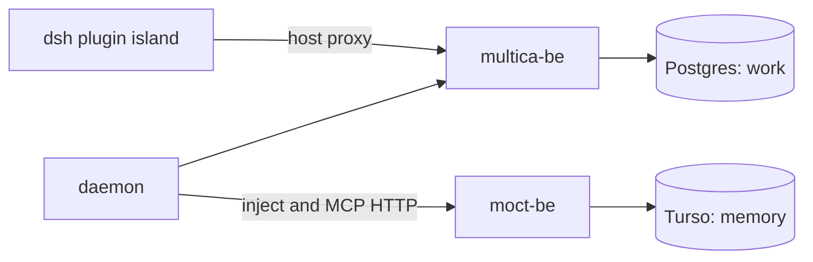

# multica-moct-x architecture

Verified against `multica-moct` at `ac8a04078`; external claims are identified below.

The fork joins a Go/Postgres work plane to a separate MOCT memory service. The
server reads `DATABASE_URL` (`server/cmd/server/main.go:395`); the lane config
separately names a MOCT repository and data file (`deploy/dsh-z/dsh-z.env:37-43`).
The MOCT side is described as TypeScript and Turso in the historical seam
contract (`docs/moct-seam.md`); its internals were not independently checked.

## Ownership and identity

The design assigns issue, task, agent and board state to Multica and memory
records to MOCT; the seam is an HTTP client, not a database handle
(`server/internal/moct/client.go:1-3`). This is the one-writer-per-entity
decision recorded in M-93/M-97; it is an architectural rule rather than a
proof about every external client. Multica's execution identity and MOCT's
knowledge profile are joined through prefixed workspace, agent, issue and
project refs (`server/internal/moct/refs.go:3-27`).

The dsh bridge carries a session id (`server/pkg/agent/dsh.go:211`). With
`MESSAGE_SINK=dsh`, dsh-runtime transcript frames are owned by the dsh
session store instead of reported as ordinary transcript frames; without the
flag the daemon uses a private per-runtime/agent root
(`server/internal/daemon/daemon.go:9038-9049,9308-9318`). This is a configured
choice, not an assertion that every lane has enabled it.

Memory and work state can diverge: failed pre-run injection returns an empty
block and the run continues (`server/internal/daemon/moct_memory.go:82-106`).
See [seam.md](seam.md) for the switch and tool failures.

## Decision record summary

M-93/M-97 chose two services and one writer per entity over a single MOCT
backend with a Postgres-to-Turso shim; the consequence is an HTTP seam and
independent failure modes. The plugin consumes the fork through a public entry
and keeps its own React tree, rather than downgrading the fork or embedding an
iframe (`packages/dsh-plugin/FORK.md:21-31,52-58`). The owner chose to hide
selected UI areas rather than remove them (`packages/dsh-plugin/FORK.md:40-47`).
The external decision threads were not re-read for this update.

## Unverified

- Current MOCT backend internals and the live dsh-x topology are outside this checkout.
- The historical ADR summary and live cross-service behavior were not re-run.
