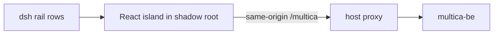

# dsh plugin

Verified against `multica-moct` at `ac8a04078`.

`packages/dsh-plugin` has a host and a browser client. Its seven rail entries
open issues, agents, skills, inbox, decisions, chat and settings
(`packages/dsh-plugin/src/client/index.ts:61-105`); they register in
`sidebar.panellist` and `main` (`packages/dsh-plugin/src/client/index.ts:257-272`).
The island attaches a shadow root and creates a React root
(`packages/dsh-plugin/src/client/island.ts:82,139`). The React 19 island and
React 18 host boundary are recorded in `packages/dsh-plugin/FORK.md:52-58`.



The host proxy defines `/multica` and `/multica/ws` and reads server URL and
token fallbacks from the host environment (`packages/dsh-plugin/src/proxy.ts:31-33,90-94`).
GitHub/Slack integrations, billing, autopilots and squads are hidden panel
areas (`packages/dsh-plugin/src/client/navigation.ts:21-27`); the fork policy
is hide rather than delete (`packages/dsh-plugin/FORK.md:40-47`).

All `@multica/*` imports enter through `src/fork.ts` and the island stylesheet;
`FORK.md` describes the public-export gate (`packages/dsh-plugin/FORK.md:21-31`).
The package lint script runs the gate (`packages/dsh-plugin/package.json:44`).
The same policy records the base and requires the island to be adapted and
tested when its rendering base moves (`packages/dsh-plugin/FORK.md:59-70`).

For build, test, lint and typecheck commands use the scripts in
`packages/dsh-plugin/package.json:40-46`, for example:

```sh
pnpm --filter @multica/dsh-plugin test
```

## Unverified

- Live shell behavior, focus and visual rendering were not re-tested.
- The dsh host's own slot implementation is in a separate repository.
