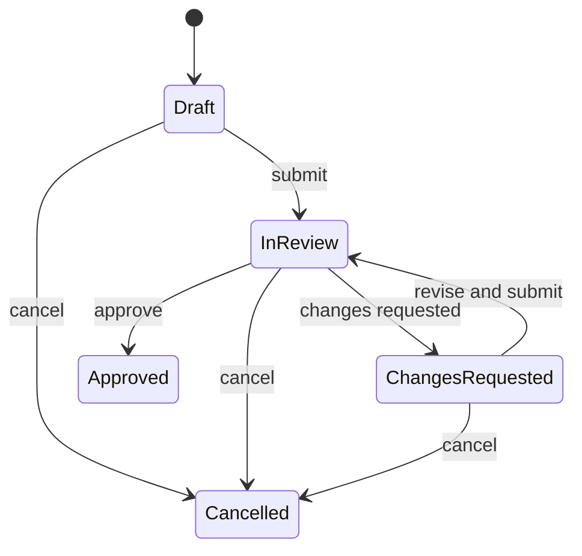

# Ask, plan and decisions

Verified against `multica-moct` at `ac8a04078`.

Multica now implements question cards and plans, as well as the dsh native
question bridge. These are distinct sources surfaced by the Decisions
projection, not one new table representing every kind of request.

## Question cards and plans

The daemon can add `multica askplan-mcp` for eligible issue tasks
(`server/internal/daemon/daemon.go:8203-8219`). Its MCP tools are named `ask`
and `plan`: successful ask or plan submission returns and parks the task; the
answer or verdict arrives in a resumed run
(`server/internal/askplanmcp/tools.go:39-46,105-106`).

The ask/plan handlers let a running issue task submit an ask or prepare and
submit a plan; a human answers the card or reviews the plan
(`server/internal/handler/askplan.go:3-15`). The router exposes plan creation,
section edits, submission, answer and verdict operations
(`server/cmd/server/router.go:1769-1773`). Submission parks the task and puts
the plan in review (`server/internal/handler/askplan.go:431-434`); the verdict
accepts `approve`, `changes_requested` or `cancel`
(`server/internal/handler/askplan.go:567-582`). Database transitions are fenced
by revision (`server/pkg/db/queries/askplan.sql:81-95,108-135`).

A timeout sweeper settles expired parked asks/plans, cancels the parked task
and escalates to the project lead when available; if there is no lead it posts
a comment without a trigger (`server/internal/service/askplan_expiry.go:1-12,51-56,273-285`).

## Native dsh questions and Decisions

The bridge supports question and answer frames and gates answers on the
advertised capability (`server/pkg/agent/dsh.go:140-202`). The Decisions query
projects open question cards, plans in review, native questions and eligible
status-only waits (`server/pkg/db/queries/decisions.sql:38-55`). The server
exposes list and detail endpoints and a human-only status response
(`server/cmd/server/router.go:1775-1777`); the plugin includes a Decisions rail
entry (`packages/dsh-plugin/src/client/index.ts:87-92`). Native answers are
associated with a specific question sequence (`server/pkg/db/queries/decisions.sql:21-34`).

## Unverified

- The historical `@multica/dsh-tools` `multica_ask` and `multica_plan` host
  plugin is outside this checkout; its current availability and runtime behavior
  were not verified. No live end-to-end park/resume was run for this document.
- Timeout configuration and lead delivery were read from code, not exercised on a lane.
