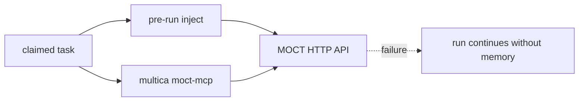

# The MOCT seam

Verified against `multica-moct` at `ac8a04078`.

The detailed historical contract is [docs/moct-seam.md](../moct-seam.md);
where it differs from the code at the verified commit, use the code and treat
external service behavior as unverified.

The ref builders produce `multica:ws:`, `multica:agent:`, `multica:issue:` and
`multica:project:` prefixes (`server/internal/moct/refs.go:7-27`). The HTTP
client calls memory inject, search, get and write endpoints under `/team/v1`
(`server/internal/moct/client.go:37,138,182,208,238`).

The daemon reads `MOCT_BASE_URL` (`server/internal/daemon/config.go:644-645`),
fetches the injection before the run (`server/internal/daemon/daemon.go:8829`),
and adds the MCP overlay (`server/internal/daemon/daemon.go:8184-8194`). The
workspace can disable pre-run injection independently of the base URL; the
memory budget is sent to MOCT (`server/internal/daemon/moct_memory.go:51-81`).
The MCP config carries scoped identity in environment variables
(`server/internal/daemon/moct_memory.go:213-244`); the tools are defined in
`server/internal/moctmcp/tools.go`.

A bad URL or failed inject returns no memory and records the reason; it does
not fail the task (`server/internal/daemon/moct_memory.go:82-106`). MCP call
errors become `isError` tool results (`server/internal/moctmcp/server.go:218-239`).
The client default timeout is 10 seconds (`server/internal/moct/client.go:30-32`),
so graceful degradation can still add latency.

## Phase 2

Per-workspace injection control and memory budget reporting exist in the
pre-run path above. Session/usage writeback and a MOCT approval UI were
previously proposed; their current delivery status has not been established in
this audit and must not be assumed from the historical plan.

## Unverified

- MOCT server behavior, approval defaults, and actual lane connectivity were not tested.
- Delivery status of session/usage writeback and memory approval UI needs a separate cross-repository check.
